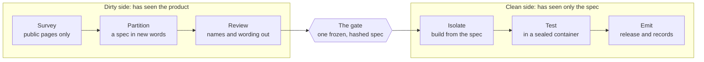

# SPITE

**Survey · Partition · Isolate · Test · Emit**

A clean-room build pipeline for [Claude Code](https://claude.com/claude-code). It takes one software product from its public documentation to an independent open-source release, and keeps the paperwork that shows how.

The name comes from the five stages. Any other reading is your own.

## The idea

A clean-room build has two sides and a wall. One side studies a product and writes down what it does. The other side never sees the product or the notes, and builds from that written description alone. What comes out is new work that does the same job.

The hard part is the wall. SPITE runs every step through a runner that enforces it: each role works in its own session with only the tools and files that role is allowed, exactly one document crosses from one side to the other, and every step writes a record.



## What you end up with

A repository on your machine, ready for you to publish, containing:

- the product, written from the specification
- conformance tests written from the same specification by a session that could not read the code
- a licence you chose (AGPL-3.0 or Apache-2.0) and a new name with no reference to the original
- `PROVENANCE.md` and a `provenance/` folder: the list of sources with dates, the frozen specification and its hash, a hash-chained record of every step on both sides, and `verify.py`, which anyone can run to confirm the records are complete and unaltered

## Install

**As a plugin.** In Claude Code:

```
/plugin marketplace add neitzert/SPITE
/plugin install spite@spite
```

The command is then `/spite:spite`.

**As a plain skill.** Copy the folder `skills/spite` to `~/.claude/skills/spite` to have it in every project, or to `.claude/skills/spite` inside one project. The command is then `/spite`.

**In the Claude apps.** Run `python skills/spite/scripts/spite.py package` and upload the `spite.skill` file it writes. There SPITE can explain itself, but it cannot run: the pipeline starts Claude Code sessions and uses git and a container runtime on your own machine.

### What you need

| | |
|---|---|
| Claude Code | 2.1.259 or later |
| Python | 3.9 or later |
| git | with your name and email set |
| Docker | or another sandbox, for running the tests of what gets built |

`python skills/spite/scripts/spite.py doctor` checks all of this and says how to fix what is missing. Where a command on this page says `python`, use `python3` on Linux and macOS.

## Try it

```
/spite:spite help
/spite:spite run the demo
```

The demo takes a made-up product through the whole process. It needs about 20 minutes and a few dollars of model usage, and touches nothing real. A second made-up release is included for trying an update.

[`skills/spite/HELP.md`](skills/spite/HELP.md) is the guide for people: what you can ask for, what you will be asked, and what it costs.

## The steps

| Step | What happens | Your part |
|---|---|---|
| **Gate** | The product is checked against four tests: its value is in its code, it can be built in under four weeks, nothing open-source already does the job, and someone pays for it today. | You answer them. |
| **Terms** | The product's terms of use are read before any other page. | You decide how its pages may be read: directly, only from copies you saved, or not at all. |
| **Survey** | Public pages only, each logged with its address and date. | |
| **Partition** | The notes become a specification in new words. A reviewer strips names, wording and anything else that belongs to the original. A second reader hunts for what the reviewer missed. | You approve any identifier that has to keep the original's name for compatibility. |
| **Freeze** | A reader who has seen nothing but the specification is asked which product it describes. If it can tell, the specification goes back. Then it is frozen and hashed. | You read it first. |
| **Isolate** | The product is built in sessions with no web access, no ability to run commands, and no view of the research. Questions go back in writing and are answered in writing. | |
| **Test** | Tests are written from the specification and run in a container with no network. Every core requirement must have a passing test. The result is scanned for anything that came from the research. | You rule on anything the scan flags. |
| **Emit** | Licence, README and the provenance bundle are prepared locally. | You choose the name and licence, and you publish. |

Two more commands sit outside that line. `scout` sifts a list of candidate products against the gate using search results alone, opening none of their pages. `update` brings a released clone up to date by the difference: the specification keeps its requirement numbers, a delta crosses the gate, and only what changed is rebuilt.

## What keeps the wall up

- **Separate sessions with nothing shared.** Each role starts fresh, without your settings, memory, plugins or connectors.
- **A guard that refuses by default.** A tool the role was not given is refused, and file access outside the role's own folders is refused. If the guard itself fails, it refuses.
- **One document crosses.** The frozen specification, checked against its hash on every clean-side action. Reviewed answers to the builders' questions cross under the same checks.
- **No code runs outside a sandbox.** Build sessions cannot execute anything. Their tests run in a container that holds only the product, read-only, with no network.
- **Checks before the gate.** Names, source addresses, copied runs of words, unapproved identifiers and open questions all stop a specification from crossing.
- **A scan after it.** The product is searched for the original's names, addresses, wording and identifiers that never crossed.
- **Records that cannot be quietly edited.** Each record carries the hash of the one before it, and the two sides pin each other where they meet.

[`skills/spite/references/isolation.md`](skills/spite/references/isolation.md) has the detail: what was verified, how, and where each of these ends.

## What it will not do

SPITE reads public material only. It does not use leaked or decompiled code, anything behind a login it has not been cleared for, or anything received in confidence. It puts a product's terms of use in front of you before reading a single page of it. It never names the original in what it ships. It never publishes for you.

Those limits are the point. A clone made by cutting them is not a clean-room build, and the records would say so.

## What it does not give you

- **Proof of what the builders already knew.** SPITE controls what a build session can read while it works. A model may have seen a product's public pages before, and no process can certify otherwise. The blind-reader check narrows this and does not close it.
- **A legal opinion.** You get a record of process. Before releasing a clone of a real company's product, have a lawyer read it.
- **A business.** It reproduces what the code does. The data, the customers and the services around a product are not in its documentation.

## Where it has been run

| System | What was run |
|---|---|
| Windows 11, Git for Windows, Python 3.12, Docker Desktop | Whole runs of the demo, an update of it, and both self-tests. SPITE was built here. |
| Ubuntu 24.04, Python 3.12, Docker 29 | A whole run of the demo from a fresh copy of this repository, start to verified release, and both self-tests. |

macOS has not been tried. If you run it there and something breaks, `doctor` and the two self-tests below are the place to start.

## Working on SPITE

Two self-tests need no model sessions and cost nothing. Each gate has a planted failure it must catch.

```
python -I skills/spite/scripts/selftest_guard.py skills/spite/scripts/spite_guard.py
python -I skills/spite/scripts/selftest_runner.py
```

`claude plugin validate .` checks the plugin and marketplace files.

## Licence

Apache-2.0. See [`LICENSE`](LICENSE).

The licence texts under `skills/spite/assets/licenses/` are there because releases made with SPITE carry one of them. They are not additional licences on SPITE itself.
